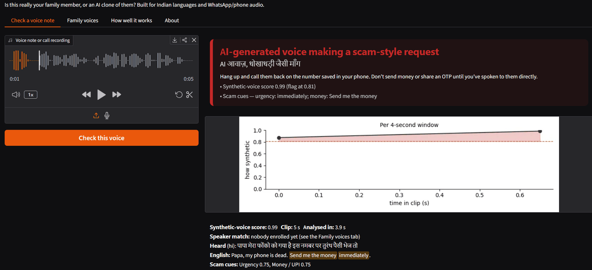
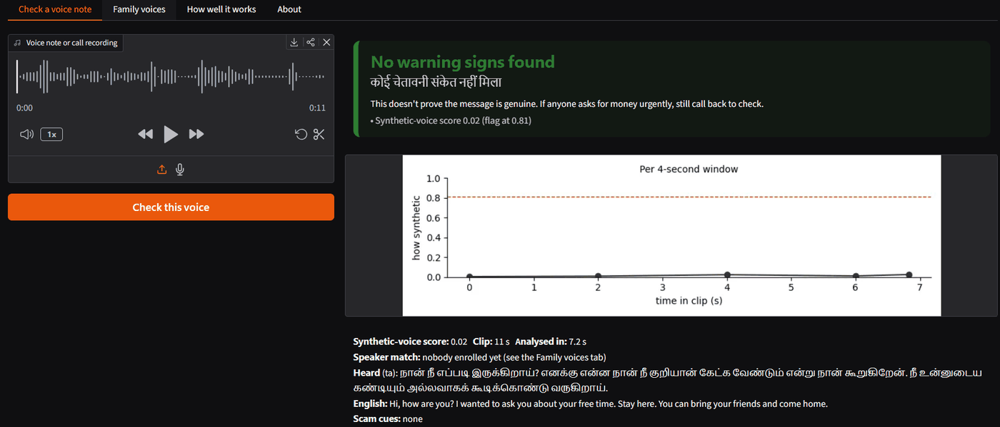
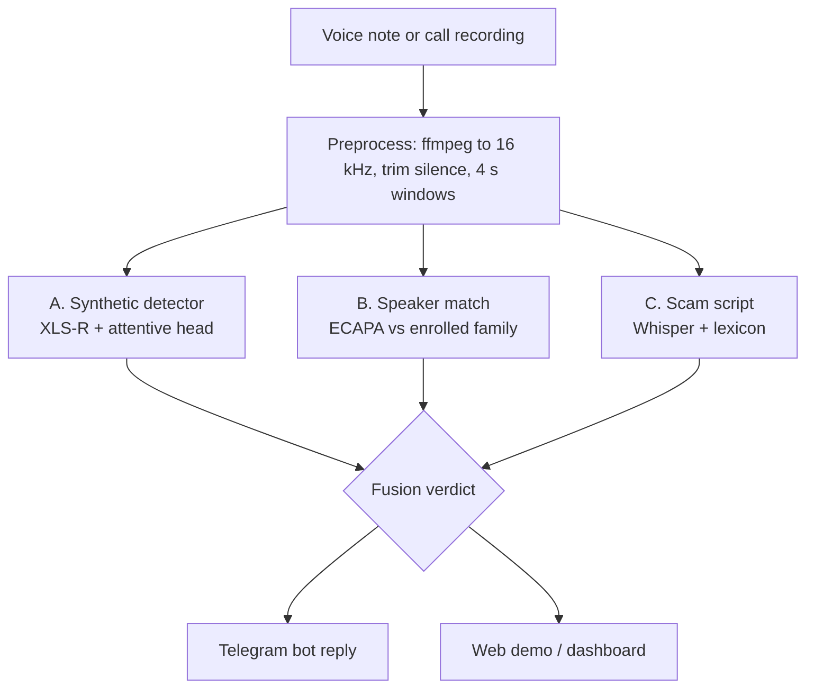
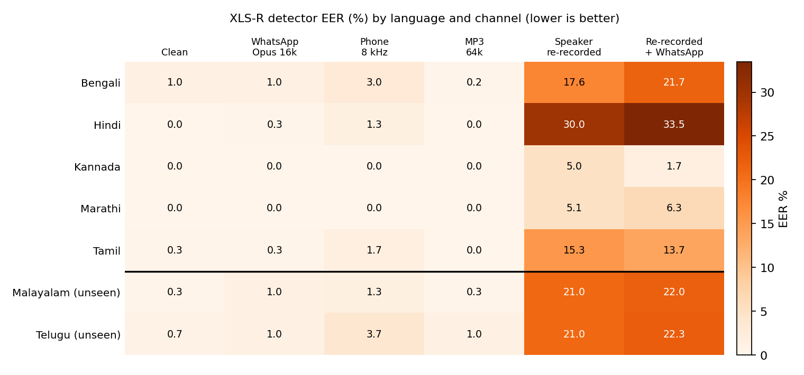
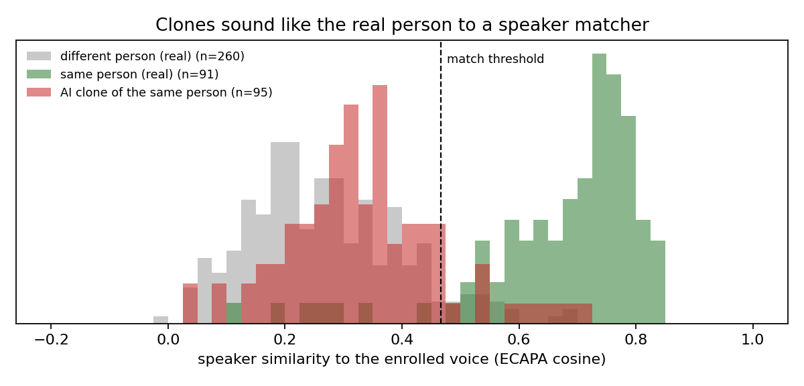
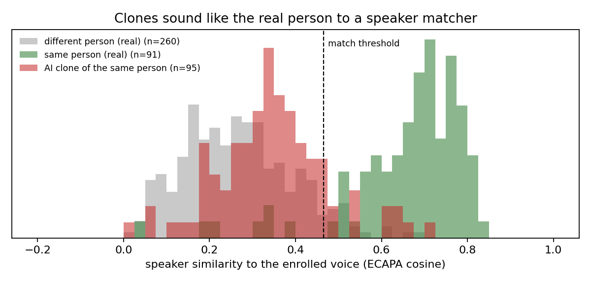

# Awaaz: voice-clone scam detection for India

**Neural Storm 2026 · Track 1: Future Tech · Problem statement FT-02: Deepfake & Synthetic Media Detection**

**Team Awaaz:** Juwairiyah · Samay

> **Is this really your brother, or an AI clone of him?** Forward a suspicious voice note to Awaaz. It checks
> whether the voice is synthetic, whether it sounds like someone you know, and whether the message follows a scam
> script, in Indian languages, on compressed WhatsApp and phone audio.

**Live demo:** [huggingface.co/spaces/Iyah26/awaaz](https://huggingface.co/spaces/Iyah26/awaaz) · **Demo video:** [YouTube](https://www.youtube.com/watch?v=m__oPgqRXBM) · **Model weights:** [Iyah26/awaaz-models](https://huggingface.co/Iyah26/awaaz-models)

**Please note initial audio processing might take ~10 seconds more than estimated time**

| A cloned voice asking for money | A real Tamil voice note |
|---|---|
|  |  |

_Screenshots of the live app._

**At a glance**
- **About 1% equal error rate** on clean, WhatsApp and MP3 audio (2.3% over an 8 kHz phone line), on speakers never heard
  in training, including **two Indian languages never seen in training** (Telugu, Malayalam: 0.67% clean).
- **13 of 14 correct on voices outside all training data:** 9/9 real WhatsApp voice notes from friends and family
  called real, and 4/5 clones of a team member's voice called fake.
- **Zero false accusations:** the "likely a cloned voice of <name>" warning never fired on the real person.
- **Shortcut audit passed:** removing dataset artifacts (digital silence, 7–8 kHz band) doesn't change accuracy.
- **Measured limits:** audio played on one phone and re-recorded on another (~18–23% EER) and a cloning tool never
  seen in training (~25% EER) are much harder; see [Limitations](#limitations-and-responsible-use).

---

## The problem

India is the country hit hardest by AI voice-clone scams. In McAfee's *Artificial Imposter* survey (1,010 Indian
respondents), **47% of Indian adults had experienced or knew someone hit by an AI voice scam**, almost double the
global average of 25%. **83% of Indian victims lost money**, and 69% said they cannot tell a cloned voice from a real
one ([Business Insider India](https://www.businessinsider.in/tech/news/7-out-of-10-indians-are-unable-to-identify-ai-voice-call-scams-and-half-fall-for-scams-with-monetary-losses/amp_articleshow/99924644.cms)).

The pattern is simple: lift a few seconds of someone's voice from social media, clone it, then call or message a
relative with an emergency. An Indore school teacher lost ₹97,000 this way
([Free Press Journal](https://www.freepressjournal.in/indore/indore-cyber-crime-43-year-old-school-teacher-falls-victim-to-ai-voice-cloning-loses-97k)).
The same cheap cloning tools are used in election disinformation: cloned audio of national leaders circulated
during the 2024 Lok Sabha election ([BOOM](https://www.boomlive.in/news/rahul-gandhi-swearing-in-prime-minister-elections-lok-sabha-2024-voice-cloning-ai-25072)),
and fact-checkers have struggled to verify audio before it spreads
([Nieman Lab](https://www.niemanlab.org/2024/05/indian-journalists-are-the-frontline-against-election-deepfakes/)).

**Why existing tools fall short:**
- They answer only "AI or human?", mostly for English and clean audio, or for professional fact-checkers.
- Detectors trained on English data perform poorly on Indian languages, as the IndicSynth paper showed
  ([ACL 2025](https://hyper.ai/en/papers/acl__2025__2025.acl-long.1070)).
- **Clones can fool speaker verification** (the same paper), so "it sounds like Mum" isn't proof.
- Compression (WhatsApp, phone lines) strips the artifacts detectors rely on
  ([Li et al., 2025](https://arxiv.org/abs/2503.17577v1)).

## What Awaaz does differently

Most detectors stop at "AI or human?". Awaaz also answers **"who is this pretending to be?"** The synthetic-voice
detector catches clones on its own; matching the voice against family members the user enrolled turns that into a
specific, actionable warning: **"likely a cloned voice of Mum, call her back on her saved number."** In testing on 19
unseen speakers, that warning **never fired on the real person**. (Measured with ECAPA, about 13% of clones passed
speaker matching on their own, and the detector caught 92% of those; see the clone-signature results.)
A third, independent check reads the message itself, so a scam is flagged even when compression has erased the
acoustic evidence or a human scammer is speaking. It runs three independent checks:

| Check | How | Question it answers |
|---|---|---|
| **A. Synthetic voice** | Frozen multilingual **XLS-R (300M)** with a learned layer mix and attentive-statistics pooling head; a from-scratch **log-mel ResNet** as baseline | Does this sound machine-made? |
| **B. Speaker match** | SpeechBrain **ECAPA-TDNN** embeddings vs. family voices the user enrolled | Who does it sound like? |
| **C. Scam script** | **faster-whisper** transcription, then a Hindi / Hinglish / English phrase lexicon | Urgency + secrecy + money / OTP + police? |



**Verdicts, not probabilities:**

| Synthetic | Matches an enrolled voice | Scam script | Verdict |
|---|---|---|---|
| high | yes | any | 🔴 **"Likely a cloned voice of Mum"**: call her back on her saved number |
| high | no | high | 🔴 AI-generated voice making a scam-style request |
| high | no | low | 🟠 AI voice (could be a bot): don't share OTPs or pay |
| low | any | high | 🟠 Sounds human, but follows a known scam script |
| low | any | low | 🟢 No warning signs found (never "verified real") |

Every verdict explains itself: a per-window "how synthetic" timeline, the matched name and similarity, and the scam
phrases that triggered it, with a Hindi headline.

**Built for Indian audio:**
- Trained on **IndicSynth** clones (mostly FreeVC24 voice conversion and XTTS-v2 TTS) vs **Kathbath** real speech, across
  5 training languages (Hindi, Kannada, Tamil, Bengali, Marathi); Telugu and Malayalam are held out entirely.
- Train/test split is **speaker-disjoint across both classes**: IndicSynth clones real Kathbath speakers with the
  same ids, so a test voice is never heard in training, neither as itself nor as a clone.
- 70% of training clips pass through a random simulated channel: WhatsApp Opus, 8 kHz phone line, MP3/AAC, room
  reverb, background noise. The eval channels use fixed settings outside the training ranges, so they test
  generalisation, not memorisation.

<!-- RESULTS:START -->
## Results

_Generated by `scripts/make_report.py` from `results/`. Detector metric: equal error rate (EER), the point where the false-alarm rate equals the miss rate._

### Detector equal error rate (lower is better)

| Model · test set | Clean | WhatsApp (Opus 16k) | Phone (8 kHz) | MP3 64k | Speaker re-recorded | Re-recorded + WhatsApp |
|---|---|---|---|---|---|---|
| **XLS-R (frozen) + attentive head** · seen languages, unseen speakers | 1.05% | 1.05% | 2.33% | 0.93% | 18.25% | 18.64% |
| XLS-R (frozen) + attentive head · unseen languages (Telugu, Malayalam) | 0.67% | 1.00% | 2.50% | 0.67% | 21.44% | 22.83% |
| **Log-mel ResNet (from scratch)** · seen languages, unseen speakers | 4.95% | 7.06% | 13.14% | 5.52% | 18.29% | 18.52% |
| Log-mel ResNet (from scratch) · unseen languages (Telugu, Malayalam) | 5.92% | 8.50% | 7.83% | 6.00% | 26.17% | 24.83% |

Test speakers were never heard in training, as themselves or as clones. Channels are applied to the test clips to simulate how scam audio actually arrives.

### XLS-R (frozen) + attentive head by language

| Language | Clean | WhatsApp (Opus 16k) | Phone (8 kHz) | Re-recorded + WhatsApp |
|---|---|---|---|---|
| Bengali | 1.00% | 1.00% | 3.00% | 21.67% |
| Hindi | 0.00% | 0.33% | 1.33% | 33.48% |
| Kannada | 0.00% | 0.00% | 0.00% | 1.69% |
| Marathi | 0.00% | 0.00% | 0.00% | 6.35% |
| Tamil | 0.33% | 0.33% | 1.67% | 13.67% |
| Malayalam *(unseen)* | 0.33% | 1.00% | 1.33% | 22.00% |
| Telugu *(unseen)* | 0.67% | 1.00% | 3.67% | 22.33% |



### Unseen cloning tool

XLS-R retrained **without any XTTS-v2 clips**, then tested on XTTS-v2 clones (real scammers will use tools we never trained on).

| Channel | Seen tool (FreeVC24) | Unseen tool (XTTS-v2) |
|---|---|---|
| Clean | 0.00% | 24.60% |
| WhatsApp (Opus 16k) | 0.00% | 23.82% |

### Shortcut audit

Real (Kathbath) and fake (IndicSynth) clips differ in two ways unrelated to the voice: real files contain ~18× more padded digital silence, and fakes resampled from 24 kHz have slightly less 7–8 kHz energy. Removing each artifact barely moves the EER, so the detector is not relying on them. Codec, bandwidth, duration, loudness and noise floor were also audited (`scripts/audit_shortcuts.py`); loudness is neutralised by normalisation.

| Test clips | XLS-R (frozen) + attentive head EER |
|---|---|
| Clean | 1.14% |
| Dither (no digital silence) | 0.99% |
| Low-pass 7 kHz | 0.68% |
| Both removed | 0.84% |

### Clone signature: matches a known voice *and* sounds synthetic

| Detector | Channel | Speakers | Clones that fool speaker matching | …of those, caught by the detector | Red “cloned voice of <name>” on clones | Red on the real person (false accusation) |
|---|---|---|---|---|---|---|
| XLS-R (frozen) + attentive head | Clean | 19 | 12.6% | 91.7% | 11.6% | 0.0% |
| XLS-R (frozen) + attentive head | WhatsApp (Opus 16k) | 19 | 13.7% | 92.3% | 12.6% | 0.0% |

Each test speaker is enrolled from 2 real clips; trials are other real clips of the same person, IndicSynth clones of that person, and real clips of other people.




### Scam-script scorer (60 labelled messages, Hindi / Hinglish / English)

| Mode | Precision | Recall | F1 |
|---|---|---|---|
| Lexicon (shipped) | 0.96 | 0.90 | 0.93 |

Half the set is deliberately tricky everyday messages (money, hospitals, police, secrets, OTP warnings). Zero-shot NLI over-fired on them, so the lexicon ships by default. The set is small and self-written: a sanity check, not a benchmark.

### Out-of-domain check: voices that are in no training data

Recorded on ordinary phones and shared over WhatsApp. None of these speakers are in Kathbath or IndicSynth, and the clones were made from a real voice note, not studio audio.

**Real WhatsApp voice notes from people outside both datasets** (expected: real)

| Clip | Seconds | XLS-R (frozen) + attentive head | Log-mel ResNet (from scratch) |
|---|---|---|---|
| Mum_hindi | 8.0 | 0.042 ✅ real | 0.017 ✅ real |
| Mum_hindi2 | 18.4 | 0.055 ✅ real | 0.005 ✅ real |
| Mum_marathi | 8.8 | 0.001 ✅ real | 0.001 ✅ real |
| Prer_tamil | 10.8 | 0.025 ✅ real | 0.002 ✅ real |
| Riri_eng | 9.7 | 0.015 ✅ real | 0.005 ✅ real |
| Riri_hindi | 12.0 | 0.031 ✅ real | 0.002 ✅ real |
| Sam_eng | 12.3 | 0.750 ✅ real | 0.925 ⚠️ fake |
| Sam_hindi | 16.9 | 0.246 ✅ real | 0.937 ⚠️ fake |
| Sam_kannada | 10.2 | 0.032 ✅ real | 0.154 ✅ real |

XLS-R (frozen) + attentive head: 9/9 correctly called real; Log-mel ResNet (from scratch): 7/9 correctly called real.

**XTTS-v2 clones of a team member's voice (scam lines), made from one WhatsApp voice note** (expected: fake)

| Clip | Seconds | XLS-R (frozen) + attentive head |
|---|---|---|
| xtts_refs_Riri_hindi_00000 | 4.8 | 0.969 ⚠️ fake |
| xtts_refs_Riri_hindi_00001 | 4.2 | 0.995 ⚠️ fake |
| xtts_refs_Riri_hindi_00002 | 5.6 | 0.917 ⚠️ fake |

XLS-R (frozen) + attentive head: 3/3 correctly called fake.

**XTTS-v2 clones of the same voice saying everyday sentences** (expected: fake)

| Clip | Seconds | XLS-R (frozen) + attentive head |
|---|---|---|
| xtts_refs_Riri_hindi_00000 | 3.7 | 0.960 ⚠️ fake |
| xtts_refs_Riri_hindi_00001 | 3.5 | 0.772 ✅ real |

XLS-R (frozen) + attentive head: 1/2 correctly called fake.

### Cost and calibration

| Model | CPU time per 4 s window | Decision threshold | Validation clip EER |
|---|---|---|---|
| XLS-R (frozen) + attentive head | 1.777 s | 0.810 | 0.18% |
| Log-mel ResNet (from scratch) | 0.073 s | 0.629 | 2.05% |
<!-- RESULTS:END -->

## Engineering for trustworthy numbers

Hackathon deepfake detectors often report near-perfect scores that come from dataset artifacts rather than the
voice. We checked for that explicitly:

- **Shortcut audit** (`scripts/audit_shortcuts.py`): compared real vs fake on codec, bitrate, sample rate,
  bandwidth (energy above 4/6/7 kHz), loudness, duration, leading silence, noise floor and digital silence.
  Two artifacts differed (padded digital silence in Kathbath; slightly less 7–8 kHz energy in fakes resampled
  from 24 kHz). **Removing each at test time barely moves the EER** (see the shortcut table above), so the
  model isn't using them. Loudness is neutralised by normalisation and random gain.
- **Speaker-disjoint, cross-class splits** and **two fully held-out languages**.
- **Unseen cloning tool**: a model trained without any XTTS-v2 clips, tested on XTTS-v2.
- **Out-of-domain voice notes**: real WhatsApp voice notes from people outside both datasets.
- **Thresholds calibrated on validation data** (`scripts/calibrate.py`) and stored in the checkpoint.
- **We tested a fancier option and shipped the simpler one** when it did better: zero-shot NLI over-fired on
  everyday messages (scam-script F1 0.93 → 0.83), so the lexicon ships by default.
- **50 automated tests** cover audio I/O, every channel codec (both code paths), metrics, the speaker-disjoint
  split, calibration, the clone-signature logic, the API, the bot text and the web demo.

## Try it

| Interface | What it's for |
|---|---|
| **Web demo** (Gradio, Hugging Face Spaces) | Upload or record a voice note, enroll family voices (kept only in your browser session) |
| **Telegram bot** | Forward a voice note, get the verdict back; `/enroll Mum` saves a family voice |
| **Streamlit dashboard** | Local analysis view with Grad-CAM, plus the results heatmap |
| **HTTP API** | `POST /analyze`, `POST /enroll`, `GET /vault` |

## Tech stack

Python 3.10+ · PyTorch · Hugging Face Transformers (XLS-R) · SpeechBrain (ECAPA-TDNN) · faster-whisper ·
FFmpeg / PyAV · NumPy / SciPy · Gradio · Streamlit · FastAPI · python-telegram-bot · Hugging Face Hub ·
pytest. Training on Kaggle (2× T4).

## Setup

```bash
# FFmpeg is required: sudo apt install ffmpeg  (or brew install ffmpeg / choco install ffmpeg)
git clone https://github.com/JuwairiyahP/awaaz.git && cd awaaz
pip install -r requirements.txt
python -m pytest -q tests          # 50 tests, about 20 s, no downloads needed
```

The trained detector is downloaded from the model repo with `python scripts/hub.py pull --only runs/xlsr/best.pt`
(set `AWAAZ_HUB_REPO`), or train your own (below).

## Run locally

```bash
# one clip from the command line (enroll a real voice first to enable the clone check)
python -m awaaz.pipeline mum_real.ogg --ckpt runs/xlsr/best.pt --enroll Mum
python -m awaaz.pipeline suspicious.ogg --ckpt runs/xlsr/best.pt

# web demo (what runs on Hugging Face Spaces)
AWAAZ_CKPT=runs/xlsr/best.pt python app/gradio_app.py

# dashboard
AWAAZ_CKPT=runs/xlsr/best.pt streamlit run app/streamlit_app.py

# HTTP API
AWAAZ_CKPT=runs/xlsr/best.pt uvicorn app.api:app --port 8000

# Telegram bot (token from @BotFather)
TELEGRAM_TOKEN=... AWAAZ_CKPT=runs/xlsr/best.pt python -m app.bot
```

## Reproduce training and every result

One resumable script runs the whole pipeline on a 2-GPU Kaggle notebook (about 2.5 hours): data download,
manifests, both detectors, calibration, evaluation grid, shortcut ablation, clone-signature experiment,
unseen-tool ablation, scam-script eval, out-of-domain scoring and this README's results section. Finished stages
are skipped and every artifact is pushed to a Hugging Face model repo, so an interrupted session simply resumes.

```bash
export HF_TOKEN=...  AWAAZ_HUB_REPO=<hf-user>/awaaz-models
bash scripts/run_all.sh
```

Step-by-step details: [KAGGLE.md](KAGGLE.md). Deployment: [deploy/hf_space/DEPLOY.md](deploy/hf_space/DEPLOY.md).

## Repository layout

```
awaaz/        core package: audio I/O, channel simulation, detectors, speaker match, scam scorer, fusion, pipeline
app/          Gradio web demo, Streamlit dashboard, FastAPI service, Telegram bot
scripts/      data fetch, manifest, training, calibration, evaluation, shortcut audit, clone signature,
              scam eval, out-of-domain scoring, report, Hugging Face Hub sync, run_all.sh
eval/         labelled scam / normal message set
deploy/       Hugging Face Space config
tests/        50 pytest tests
```

## Limitations and responsible use

- **A warning system, not proof.** Red verdicts always tell the user to hang up and call back on a saved number.
  Green says "no warning signs found", never "verified real".
- **Re-recorded audio is the weakest case (~18–23% EER).** A clip played on one phone's speaker and recorded on
  another loses much of what the detector relies on; this chain isn't in training. Adding simulated
  re-recordings to training is the next step.
- **A cloning tool never seen in training is much harder (~25% EER):** a model trained without XTTS-v2 struggled on
  XTTS-v2. The shipped model was trained on both tools, which is why it caught clones of our own voices.
- **Short clips are less reliable.** The one clone we missed was 3.5 s long (score 0.77 vs. threshold 0.81), and one
  real English voice note scored 0.75, close to the threshold. Longer voice notes give more evidence.
- **The scam-script check reads words, not intent.** Someone saying "send money urgently" as a joke gets an amber
  "sounds human, but follows a scam script" verdict. That's deliberate: it also catches a human scammer.
- **Speaker matching alone doesn't catch most clones** (~13% passed it in our test); it makes warnings specific
  rather than doing the detecting.
- **New cloning tools may evade the detector.** We measure this (unseen-tool result), and the scam-script check
  is a second line of defence that doesn't depend on acoustics.
- **Training data covers two cloning tools and seven languages.** Accents, recording conditions and tools
  outside these may score differently; the out-of-domain check is small (a few speakers).
- **The scam-script set is small and self-written** (60 messages): a sanity check, not a benchmark.
- **Privacy:** uploaded audio is deleted right after analysis. Enrolled voices are stored only as 192-number
  embeddings: in the web demo, only in the visitor's browser session; in the bot, per chat.
- **Consent:** demo clones were made only from the voices of team members who agreed to it.

## Datasets, models and licences

- **IndicSynth** (Sharma, Ekbote & Gupta, ACL 2025): synthetic speech in 12 Indian languages, CC BY-NC 4.0
  ([dataset](https://huggingface.co/datasets/vdivyasharma/IndicSynth))
- **Kathbath** (AI4Bharat, IndicSUPERB): real read speech in 12 Indian languages, CC BY 4.0
  ([dataset](https://huggingface.co/datasets/ai4bharat/Kathbath))
- **XLS-R 300M** (Meta), **ECAPA-TDNN** (SpeechBrain, VoxCeleb), **Whisper** via faster-whisper (OpenAI),
  **mDeBERTa-v3 XNLI** (optional), **XTTS-v2** (Coqui Public Model License, used only to make demo/test clones)

Because IndicSynth is non-commercial, the trained detector is for research and demonstration use.

## AI development tools used

Claude (Anthropic) was used as a coding and research assistant: drafting the proposal, scaffolding code, writing
tests and debugging, and to produce the demo video. The video's voice-over is synthetic, generated with
**Kokoro** (open-weight TTS); no real person's voice was cloned for it.
