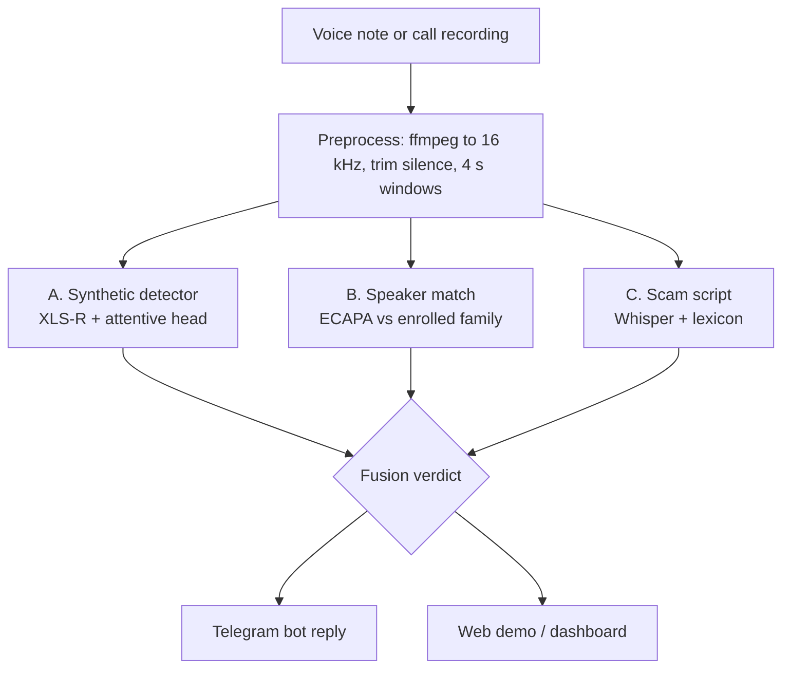

# Awaaz: voice-clone scam detection for India

**Neural Storm 2026 · Track 1: Future Tech · Problem statement FT-02: Deepfake & Synthetic Media Detection**

**Team:** _TEAM NAME_ · _Member names_

> **Is this really your brother, or an AI clone of him?** Forward a suspicious voice note to Awaaz. It checks
> whether the voice is synthetic, whether it sounds like someone you know, and whether the message follows a scam
> script, in Indian languages, on compressed WhatsApp and phone audio.

**Live demo:** _Hugging Face Space link_ · **Demo video:** _link_ · **Model weights:** _Hugging Face model repo link_

_Screenshot / demo GIF here_

---

## The problem

India is the country hit hardest by AI voice-clone scams. In McAfee's *Artificial Imposter* survey (1,010 Indian
respondents), **47% of Indian adults had experienced or knew someone hit by an AI voice scam**, almost double the
global average of 25%. **83% of Indian victims lost money**, and 69% said they cannot tell a cloned voice from a real
one ([Business Insider India](https://www.businessinsider.in/tech/news/7-out-of-10-indians-are-unable-to-identify-ai-voice-call-scams-and-half-fall-for-scams-with-monetary-losses/amp_articleshow/99924644.cms)).

The pattern is simple: lift a few seconds of someone's voice from social media, clone it, then call or message a
relative with an emergency. An Indore school teacher lost ₹97,000 this way
([Free Press Journal](https://www.freepressjournal.in/indore/indore-cyber-crime-43-year-old-school-teacher-falls-victim-to-ai-voice-cloning-loses-97k)).
The same cheap cloning tools are used in election disinformation: cloned audio of national leaders circulated
during the 2024 Lok Sabha election ([BOOM](https://www.boomlive.in/news/rahul-gandhi-swearing-in-prime-minister-elections-lok-sabha-2024-voice-cloning-ai-25072)),
and fact-checkers have struggled to verify audio before it spreads
([Nieman Lab](https://www.niemanlab.org/2024/05/indian-journalists-are-the-frontline-against-election-deepfakes/)).

**Why existing tools fall short:**
- They answer only "AI or human?", mostly for English and clean audio, or for professional fact-checkers.
- Detectors trained on English data perform poorly on Indian languages, as the IndicSynth paper showed
  ([ACL 2025](https://hyper.ai/en/papers/acl__2025__2025.acl-long.1070)).
- **Clones fool speaker verification** (the same paper), so "it sounds like Mum" proves nothing.
- Compression (WhatsApp, phone lines) strips the artifacts detectors rely on
  ([Li et al., 2025](https://arxiv.org/abs/2503.17577v1)).

## What Awaaz does differently

Awaaz turns the weakness into a signal. If clones fool speaker matching, then **a voice that matches someone you
know *and* sounds synthetic is the fingerprint of a targeted clone attack.** It runs three independent checks:

| Check | How | Question it answers |
|---|---|---|
| **A. Synthetic voice** | Frozen multilingual **XLS-R (300M)** with a learned layer mix and attentive-statistics pooling head; a from-scratch **log-mel ResNet** as baseline | Does this sound machine-made? |
| **B. Speaker match** | SpeechBrain **ECAPA-TDNN** embeddings vs. family voices the user enrolled | Who does it sound like? |
| **C. Scam script** | **faster-whisper** transcription, then a Hindi / Hinglish / English phrase lexicon | Urgency + secrecy + money / OTP + police? |



**Verdicts, not probabilities:**

| Synthetic | Matches an enrolled voice | Scam script | Verdict |
|---|---|---|---|
| high | yes | any | 🔴 **"Likely a cloned voice of Mum"**: call her back on her saved number |
| high | no | high | 🔴 AI-generated voice making a scam-style request |
| high | no | low | 🟠 AI voice (could be a bot): don't share OTPs or pay |
| low | any | high | 🟠 Sounds human, but follows a known scam script |
| low | any | low | 🟢 No warning signs found (never "verified real") |

Every verdict explains itself: a per-window "how synthetic" timeline, the matched name and similarity, and the scam
phrases that triggered it, with a Hindi headline.

**Built for Indian audio:**
- Trained on **IndicSynth** clones (FreeVC24 voice conversion and XTTS-v2 TTS) vs **Kathbath** real speech, across
  5 training languages (Hindi, Kannada, Tamil, Bengali, Marathi); Telugu and Malayalam are held out entirely.
- Train/test split is **speaker-disjoint across both classes**: IndicSynth clones real Kathbath speakers with the
  same ids, so a test voice is never heard in training, neither as itself nor as a clone.
- Every training clip passes through simulated channels: WhatsApp Opus, 8 kHz phone line, MP3/AAC, room reverb,
  speaker re-recording, background noise.

<!-- RESULTS:START -->
## Results

_Filled in by `python scripts/make_report.py --update-readme` from `results/`._
<!-- RESULTS:END -->

## Engineering for trustworthy numbers

Hackathon deepfake detectors often report near-perfect scores that come from dataset artifacts rather than the
voice. We checked for that explicitly:

- **Shortcut audit** (`scripts/audit_shortcuts.py`): compared real vs fake on codec, bitrate, sample rate,
  bandwidth (energy above 4/6/7 kHz), loudness, duration, leading silence, noise floor and digital silence.
  Two artifacts differed (padded digital silence in Kathbath; slightly less 7–8 kHz energy in fakes resampled
  from 24 kHz). **Removing each at test time barely moves the EER** (see the shortcut table above), so the
  model isn't using them. Loudness is neutralised by normalisation and random gain.
- **Speaker-disjoint, cross-class splits** and **two fully held-out languages**.
- **Unseen cloning tool**: a model trained without any XTTS-v2 clips, tested on XTTS-v2.
- **Out-of-domain voice notes**: real WhatsApp voice notes from people outside both datasets.
- **Thresholds calibrated on validation data** (`scripts/calibrate.py`) and stored in the checkpoint.
- **We tested a fancier option and shipped the simpler one** when it did better: zero-shot NLI over-fired on
  everyday messages (scam-script F1 0.93 → 0.83), so the lexicon ships by default.
- **47 automated tests** cover audio I/O, every channel codec (both code paths), metrics, the speaker-disjoint
  split, calibration, the clone-signature logic, the API, the bot text and the web demo.

## Try it

| Interface | What it's for |
|---|---|
| **Web demo** (Gradio, Hugging Face Spaces) | Upload or record a voice note, enroll family voices (kept only in your browser session) |
| **Telegram bot** | Forward a voice note, get the verdict back; `/enroll Mum` saves a family voice |
| **Streamlit dashboard** | Local analysis view with Grad-CAM, plus the results heatmap |
| **HTTP API** | `POST /analyze`, `POST /enroll`, `GET /vault` |

## Tech stack

Python 3.10+ · PyTorch · Hugging Face Transformers (XLS-R) · SpeechBrain (ECAPA-TDNN) · faster-whisper ·
FFmpeg / PyAV · NumPy / SciPy · Gradio · Streamlit · FastAPI · python-telegram-bot · Hugging Face Hub ·
pytest. Training on Kaggle (2× T4).

## Setup

```bash
# FFmpeg is required: sudo apt install ffmpeg  (or brew install ffmpeg / choco install ffmpeg)
git clone https://github.com/JuwairiyahP/awaaz.git && cd awaaz
pip install -r requirements.txt
python -m pytest -q tests          # 47 tests, about 20 s, no downloads needed
```

The trained detector is downloaded from the model repo with `python scripts/hub.py pull --only runs/xlsr/best.pt`
(set `AWAAZ_HUB_REPO`), or train your own (below).

## Run locally

```bash
# one clip from the command line (enroll a real voice first to enable the clone check)
python -m awaaz.pipeline mum_real.ogg --ckpt runs/xlsr/best.pt --enroll Mum
python -m awaaz.pipeline suspicious.ogg --ckpt runs/xlsr/best.pt

# web demo (what runs on Hugging Face Spaces)
AWAAZ_CKPT=runs/xlsr/best.pt python app/gradio_app.py

# dashboard
AWAAZ_CKPT=runs/xlsr/best.pt streamlit run app/streamlit_app.py

# HTTP API
AWAAZ_CKPT=runs/xlsr/best.pt uvicorn app.api:app --port 8000

# Telegram bot (token from @BotFather)
TELEGRAM_TOKEN=... AWAAZ_CKPT=runs/xlsr/best.pt python -m app.bot
```

## Reproduce training and every result

One resumable script runs the whole pipeline on a 2-GPU Kaggle notebook (about 2.5 hours): data download,
manifests, both detectors, calibration, evaluation grid, shortcut ablation, clone-signature experiment,
unseen-tool ablation, scam-script eval, out-of-domain scoring and this README's results section. Finished stages
are skipped and every artifact is pushed to a Hugging Face model repo, so an interrupted session simply resumes.

```bash
export HF_TOKEN=...  AWAAZ_HUB_REPO=<hf-user>/awaaz-models
bash scripts/run_all.sh
```

Step-by-step details: [KAGGLE.md](KAGGLE.md). Deployment: [deploy/hf_space/DEPLOY.md](deploy/hf_space/DEPLOY.md).

## Repository layout

```
awaaz/        core package: audio I/O, channel simulation, detectors, speaker match, scam scorer, fusion, pipeline
app/          Gradio web demo, Streamlit dashboard, FastAPI service, Telegram bot
scripts/      data fetch, manifest, training, calibration, evaluation, shortcut audit, clone signature,
              scam eval, out-of-domain scoring, report, Hugging Face Hub sync, run_all.sh
eval/         labelled scam / normal message set
deploy/       Hugging Face Space config
tests/        47 pytest tests
```

## Limitations and responsible use

- **A warning system, not proof.** Red verdicts always tell the user to hang up and call back on a saved number.
  Green says "no warning signs found", never "verified real".
- **New cloning tools may evade the detector.** We measure this (unseen-tool result), and the scam-script check
  is a second line of defence that doesn't depend on acoustics.
- **Training data covers two cloning tools and seven languages.** Accents, recording conditions and tools
  outside these may score differently; the out-of-domain check is small (a few speakers).
- **The scam-script set is small and self-written** (60 messages): a sanity check, not a benchmark.
- **Privacy:** uploaded audio is deleted right after analysis. Enrolled voices are stored only as 192-number
  embeddings: in the web demo, only in the visitor's browser session; in the bot, per chat.
- **Consent:** demo clones were made only from the voices of team members who agreed to it.

## Datasets, models and licences

- **IndicSynth** (Sharma, Ekbote & Gupta, ACL 2025): synthetic speech in 12 Indian languages, CC BY-NC 4.0
  ([dataset](https://huggingface.co/datasets/vdivyasharma/IndicSynth))
- **Kathbath** (AI4Bharat, IndicSUPERB): real read speech in 12 Indian languages, CC BY 4.0
  ([dataset](https://huggingface.co/datasets/ai4bharat/Kathbath))
- **XLS-R 300M** (Meta), **ECAPA-TDNN** (SpeechBrain, VoxCeleb), **Whisper** via faster-whisper (OpenAI),
  **mDeBERTa-v3 XNLI** (optional), **XTTS-v2** (Coqui Public Model License, used only to make demo/test clones)

Because IndicSynth is non-commercial, the trained detector is for research and demonstration use.

## AI development tools used

Claude (Anthropic) was used as a coding and research assistant: drafting the proposal, scaffolding code, writing
tests and debugging. _List any other tools used._
